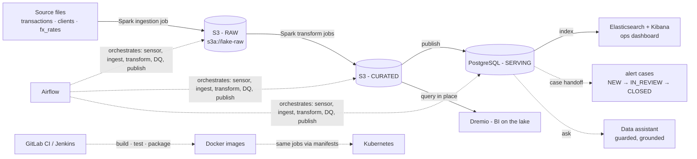

# banking-datahub

A mini banking data hub built for learning by doing: Spark/Scala pipelines, object storage,
orchestration and CI in a laptop-sized, fully local setup. Synthetic data only — no cloud account,
no licenses, no external services.

 — built in phases, see [Roadmap](#roadmap)

## Architecture



Detailed flows (idempotent reruns, data-quality gate): [docs/architecture.md](docs/architecture.md) ·
data contracts: [docs/datamodel.md](docs/datamodel.md)

## What it demonstrates

| capability | where |
|---|---|
| raw-layer ingestion (csv → parquet, date-partitioned) | `modules/ingestion` |
| curated transformations: validation, dedup, FX conversion | `modules/transform` |
| behavioral features (rolling windows, z-scores) + 5 detection rules grounded in public typologies (FATF, FinCEN, EU AMLD) | `modules/transform`, `docs/detection-rules.md` |
| data-quality framework with per-run reports, fail vs rejects routing | `modules/quality` |
| pseudonymization of client identity in the serving zone | `modules/transform` |
| orchestration: TaskFlow DAGs, deferrable file sensor | `airflow/dags` |
| Oozie → Airflow migration study (workflow.xml mapping, parallel-run cutover) | `docs/migration-guide.md` |
| Hadoop → cloud migration track: legacy artifacts, HiveQL reference, reconciliation | `migration/`, `docs/migration-guide.md` |
| unit tests with a local Spark session | `modules/*/src/test` |
| CI: GitLab CI + Jenkinsfile | `.gitlab-ci.yml`, `Jenkinsfile` |
| Dremio: bi queries straight on the lake (no data copy) | dremio service + `docs/dremio.md` |
| kibana ops dashboard over the serving layer (alert indexing + data views) | `scripts/publish_to_es.py`, `docs/ops-dashboard.md` |
| column-level data dictionary for every table + the day-to-day runbook | `docs/data-dictionary.md`, `docs/runbook.md` |
| alert → case handoff with lifecycle + audit trail (appian-style) | `scripts/alert_cases.py`, `docs/case-handoff.md` |
| data assistant: grounded, guarded answers over the serving tables | `scripts/data_assistant.py`, `docs/data-assistant.md` |
| Spark on Kubernetes: the six pipeline jobs as cluster pods (kind, rbac) | `k8s/`, `docs/kubernetes.md` |

This table is the target state — until a phase is checked in the Roadmap, its rows describe
what is being built, not what exists yet.

## Stack

Scala 2.12 · Spark 3.5 (sbt multi-module) · SeaweedFS (S3-compatible object storage) ·
PostgreSQL (serving) · Dremio (bi on the lake) · Elasticsearch + Kibana (ops
dashboard) · Airflow · Python (synthetic data generator + serving scripts) ·
Docker Compose · GitLab CI / Jenkins · Kubernetes manifests

## Quickstart

Prerequisites: JDK 17, sbt, Docker, Python 3.9+

```bash
docker compose up -d                        # s3 (seaweedfs, api :8333) + postgres (:5436) + dremio (:9047)
pip install -r scripts/requirements.txt
python scripts/generate_data.py --samples   # synthetic data -> data/output/ (+ data/samples/)
python scripts/bootstrap_buckets.py         # create lake-raw / lake-curated on the s3 store
sbt compile
```

One-command end-to-end run for today's date (ingest → curate → features → detect → data quality):

```bash
./scripts/run_pipeline.sh            # or pass a date: ./scripts/run_pipeline.sh 2026-11-17
```

What it does: uploads the feeds to the raw inbox on the s3 store, assembles the three job jars, and
submits the six jobs with spark-submit in the official `apache/spark` container on the compose
network, landing parquet partitions in `lake-raw/raw/` and `lake-curated/` plus the DQ report.
S3 master UI: http://localhost:9333 · Dremio: http://localhost:9047 · Airflow UI
http://localhost:8080 · Kibana: http://localhost:5601 (after `scripts/publish_to_es.py`).

## Project layout

```
modules/common       entities, config (HOCON), storage layout
modules/ingestion    raw-layer ingestion          (phase 1)
modules/transform    curated jobs + features     (phase 2)
modules/quality      DQ checks + reports         (phase 2)
migration/           legacy Oozie/Hive artifacts + the migration track
airflow/             DAGs                        (phase 4)
k8s/                 Spark-on-K8s manifests      (stretch)
scripts/             data generator, inbox upload, bucket bootstrap, serving/dashboard/case tools
docs/                architecture (sequence diagrams), data dictionary, runbook,
                     data model, migration guide,
                     dremio, ops dashboard, case handoff, data assistant,
                     detection rules, lake browsing
```

## Roadmap

- [x] phase 0 — skeleton, local storage stack, synthetic data generator
- [x] phase 1 — raw-layer ingestion with Spark
- [x] phase 2 — curated transformations, features, detection rules, DQ checks, pseudonymization
- [x] phase 3 — unit tests (19 green), legacy baseline + reconciliation job, GitLab CI + Jenkinsfile
- [x] phase 4 — Airflow orchestration (eod chain + reconciliation dags), Oozie-to-Airflow migration study
- [x] phase 5 — serving & bi: dremio on the lake, kibana ops dashboard, alert case
      handoff (appian-style), data-assistant bot grounded in the serving layer
- [x] kubernetes — the pipeline runs as cluster pods (kind, k8s/ manifests),
      driver/executor rbac, spark image; docs/kubernetes.md
- [ ] stretch — kafka event ingestion

## License

MIT
