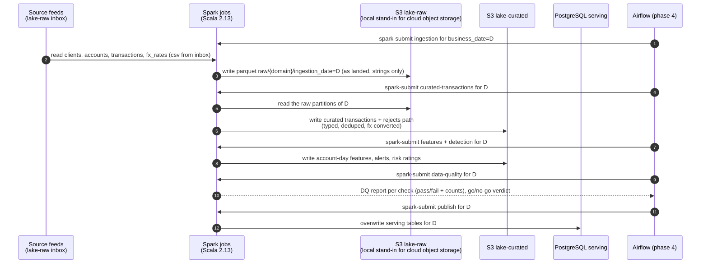
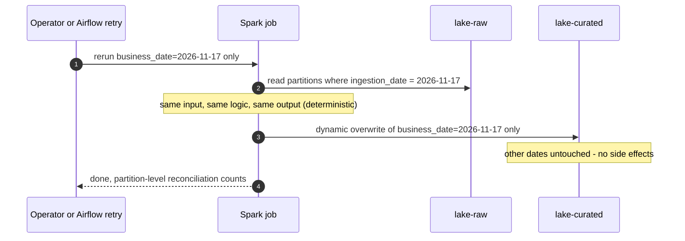
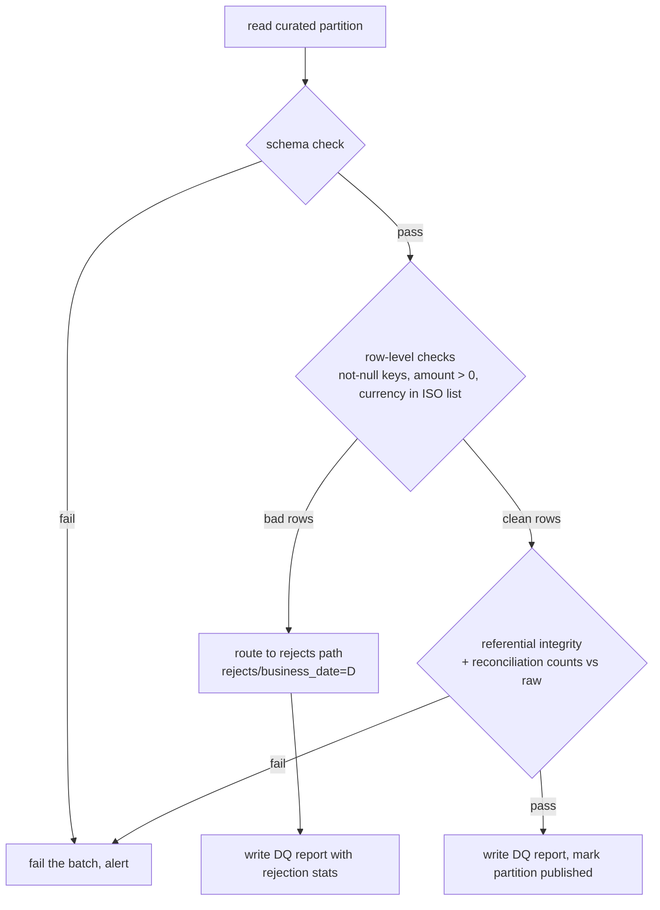
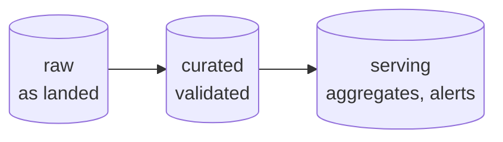

# Architecture — sequence diagrams

Diagram-first reference: one mechanism per diagram. The stack is intentionally laptop-sized —
the local s3 service is a stand-in for any S3-compatible cloud object storage, so the same jobs move to a
managed environment by changing config only.

## 1. End-of-day flow: files → raw → curated → serving (one run)

## 2. Rerun of a single date (why the pipeline is idempotent)

## 3. Data-quality gate (one partition)

## 4. Zones and write modes

| zone | partitioned by | write mode | content |
|---|---|---|---|
| raw | `ingestion_date` | one partition per run, immutable | source data exactly as landed |
| curated | `business_date` | dynamic overwrite per date | validated, deduplicated, enriched |
| serving | `business_date` | overwrite per date | aggregates and alert tables |

## Dremio: bi queries straight on the lake

The curated layer lives as parquet on object storage. Dremio reads it **in place** -
no data copy, no ingestion step: connect the s3 source, define virtual views over the
curated folders, and business users get sql on the lake. This is the "dremio on the
lake" serving pattern - the bi tool queries the lake directly, while the postgres
serving layer keeps a small row-level copy for the fastest dashboards.

## Design notes

- **Parquet past ingestion** — columnar, compressed, schema embedded, predicate pushdown.
- **Date partitioning** — every downstream query filters on a date; a rerun overwrites exactly one
  partition, which is what makes the pipeline idempotent (diagram 2).
- **Fail vs quarantine** — schema and reconciliation failures stop the batch; row-level problems
  are routed to a rejects path with stats in the DQ report (diagram 3).
- **Config, not code, separates environments** — local, staging and production differ only by
  `application.conf` (endpoint, credentials, bucket names).
